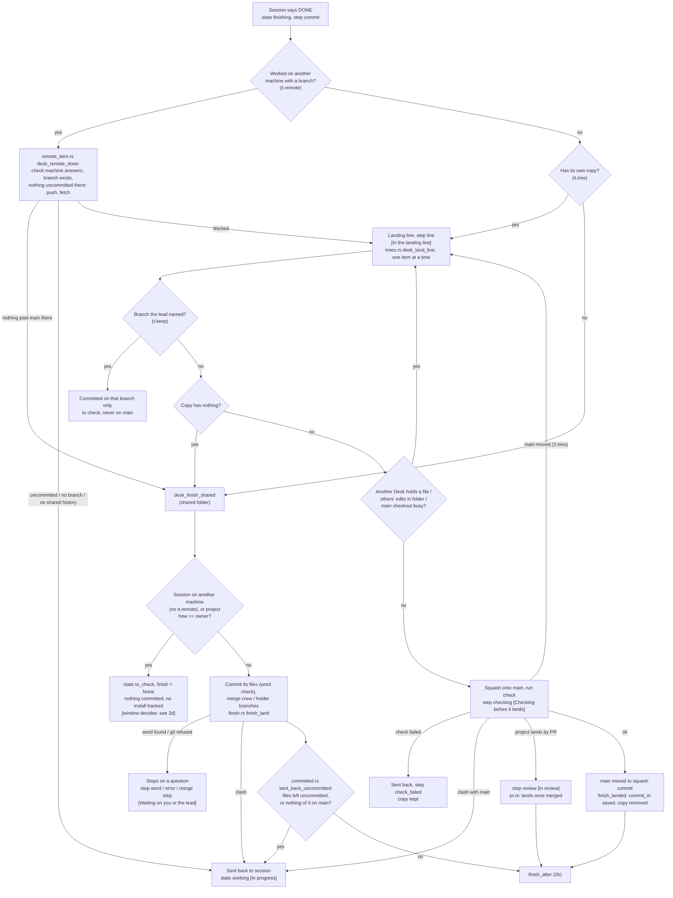
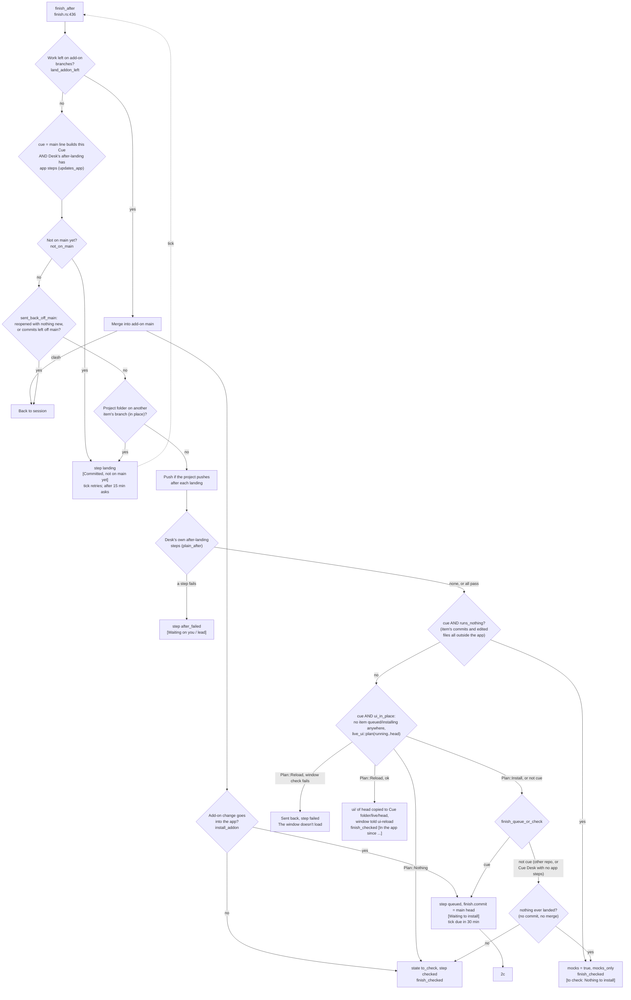
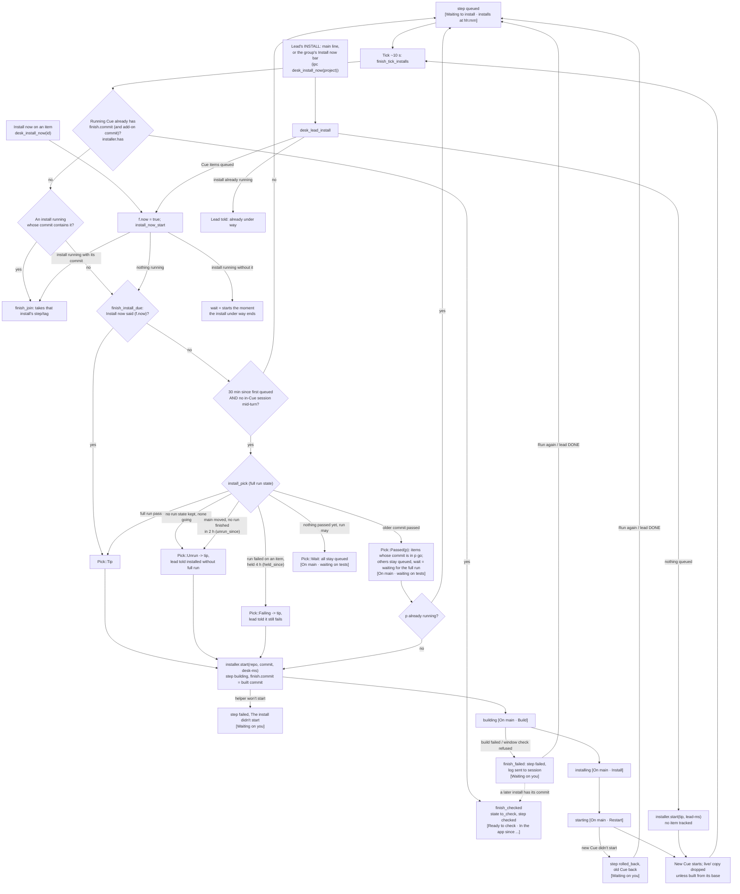

# From DONE to "to check": the whole path, and the spots that look patched on

Written 2026-11-25 for #919. The code read is `main` as of today (it has the #919 fix, b91d8bd353). Line numbers are
`main`'s. Rust paths are under `src-tauri/src/`.

## 1. Short summary

- After a session says DONE, Cue commits its work, lands it on main, runs the Desk's own steps after landing, and
  then does one of three things. It **waits for an install**: the item is "finishing" at step `queued`, and the
  window shows it under "Waiting to install". It **serves the window's files live**, with no install. Or it
  **goes to check at once** because nothing the app runs changed (marked as mocks).
- Only the first path waits for Cue to be rebuilt. The other two put the item in "to check" while the installed
  build is older. That is by design, but three separate pieces of code decide which path an item takes, and #913
  slipped between them.
- Beyond #913 I found one real gap. A window change served live can drop out of the app again while its item stays
  "In the app": the live copy is thrown away when a Cue built from an older commit starts.

## 2. Flow chart

What you see for each state is in brackets. Item states are `working`, `finishing`, `needs_you`, `to_check` and
`done`. While an item is `finishing`, its finish step (`finish.step`) is one of `commit`, `line`, `checking`,
`review`, `landing`, `queued`, `building`, `installing`, `starting`, `checked`, `failed` or `rolled_back`.

### 2a. DONE to "on main"

### 2b. On main to "to check" or "queued"

### 2c. Queued to installed

Full run (`full_run.rs`): after each landing, and once a minute on the tick, a run of every test starts at main's
head. It runs on the chosen machine, or on this Mac once nothing is building (waiting 30 minutes at most,
`QUIET_WAIT_MS`). If a machine gives no answer for 90 minutes, the run is made here instead. A pass moves `good`. A
failure traced to an item's commit reopens that item and holds installs on the last commit that passed
(`held_since`). A failure no item caused moves `good` anyway.

### 2d. How the window groups it

| Hub state | Window test | Group / words |
|---|---|---|
| `finishing`, step `commit`/`line`/`checking`/`landing` | `deskLane` = "landing" | Working · "In the landing line", "Committed, not on main yet" |
| `finishing`, step `queued`/`building`/`installing`/`starting` | `deskLane` = "install" | **Waiting to install** (`deskCInstallHead`, named by the Desk's app steps) |
| `finishing` with a question | `deskLane` = "" | Waiting on you / with the work |
| `to_check`, `finish` = None, `check.cue`, exe older than the item's newest file | `deskInstallWait` true | **Waiting to install** · "Lands with the next install" |
| `to_check`, `finish.mocks` | `deskReadyToReview` | **to check** · "Nothing to install" / "Mocks · open the canvas" |
| `to_check`, step `checked` | `deskReadyToReview` | **to check** · "In the app since <time it was checked>" |

`deskInstallWait` (`ui/desk/desk.js:114`) only matters for items with no `finish` (another machine, a project whose
work you commit yourself, older items). Every item that went through the queue has a `finish.commit`, so
`deskFinCommit` keeps it out of "Waiting to install" once it's to check.

## 3. Spots that look hacked

1. **Three separate checks decide "nothing to install", and #913 fell between them.**
   - Where:
     - `desk/hub/landing/finish.rs:552`: `runs_nothing`
     - `finish.rs:663`: `live_ui::plan` returning `Plan::Nothing`
     - `finish.rs:493`: `nothing` in `finish_queue_or_check`
   - What: each one judges from different inputs.
     - `runs_nothing` looks at the commits Cue made or merged for the item, plus the files its session's log says it
       edited.
     - `Plan::Nothing` looks at everything on main between the running build's commit and main's tip.
     - `nothing` checks whether the item has any commit or merge at all.
   - Why it looks patched on: each was added for one incident (#408, #432, #543, and now #919). The first answers a
     question about the item, the second a question about main. When they disagree, the item takes whichever path
     comes first.
   - Clean version: one function, "what this item put on main", that returns its paths. Record main's head when the
     item's finishing begins and diff it against the head after its merges, limited to the item's own paths. The
     queue-or-check choice, the mocks flag and the window's words would all read that one answer.

2. **`runs_nothing` stitches two unreliable sources together** (`desk/hub/landing/main_line.rs:327`).
   - What: it uses Cue's commits for the item (which miss anything the session committed itself) and the paths in
     the session's log (which miss anything a shell command wrote). `never_in` then treats "never in any commit" as
     "a scratch file".
   - Why it looks patched on: before #919 the second source only counted when the first was empty. Now both must
     agree. It is still a guess at what landed, not a reading of it. A session that commits an app change itself,
     writing the file with `sed` (not in the log), would still be judged by Cue's test-only commit.
   - Clean version: the same as item 1, a diff on main rather than a log of edits.

3. **A window change served live says "In the app" but isn't installed, and it can drop out again.**
   - Where:
     - `finish.rs:654` (`ui_in_place`)
     - `install/live_ui.rs:282-296` (`at_start` / `kept_in`)
     - `ui/desk/list.js:121` (`deskInAppSince`)
   - What: #914 and #915 went this way. The window's files at main's tip are copied to `<Cue folder>/live/<commit>`,
     the window reloads, and `finish_checked` runs. On every start, a Cue built from any commit other than the live
     copy's `base` deletes the copy.
   - Why it looks patched on: it is a shortcut that only works for Cue, and it has three loose ends:
     - The item reads "In the app since …", like an installed one. Nothing records that it was served, not
       installed (`finish.step` is just `checked`).
     - It skips the full-run gate. Window code goes live before its tests pass, while Rust changes wait for a passing
       full run.
     - The live copy is dropped for *any* new Cue, even one built from an *older* commit. That happens with
       `Pick::Passed(p)` when p comes before the served commit: for example, a failed install retried with its old
       commit (`begun` keeps `finish.commit`), or `./install.sh` run from an older tree. The window then loses the
       change while its item stays to check or done, and nothing reopens it.
   - Clean version:
     - Give it its own finish step (`served`) and words ("In the window now · in the next install").
     - In `kept_in`, keep the copy unless the new running commit contains it (`is_ancestor(served, running)`).
     - Or never let an install build a commit older than what's served.
   - Is the reload itself clean? Yes. `plan` only reloads when nothing outside `ui/` that the app uses changed
     between the running build and the tip, so the Rust really is the same. It's the label and the durability that
     aren't.

4. **The window makes its own install decision from timestamps** (`ui/desk/desk.js:110-118`).
   - What: for an item to check with no `finish`, `deskInstallWait` compares `installed_ms` (the mtime of the
     running executable, `desk/hub/lead/checks.rs:96`) with `check.edited` (the newest mtime of the item's files).
     The hub decides the same thing everywhere else by commit ancestry (`installer.has`).
   - Why it looks patched on: the window and the hub decide the same thing twice, by different rules:
     - Any install after the edit flips the item to "to check", even one that doesn't contain the work (a project
       you commit yourself, where nothing was committed yet).
     - `deskFinCommit` treats "has a finish commit" as "installed".
     - `deskInAppSince` says "In the app" for any item where `check.cue` isn't false. `check.cue` is set in
       `desk/hub/lead/checks.rs:44` from whether the project builds Cue (`builds_this_cue`) alone, ignoring whether
       its steps after landing install the app (`updates_app`). So an item on a Cue Desk whose after-landing has no
       app steps went to check with nothing installed, yet reads "In the app".
   - Clean version: the hub sends one field per item, `in_app: installed | served | waiting | none` (with the commit
     and time), and the window only draws it. Until then, `check.cue` should also require `updates_app()` for the
     item's Desk.

5. **The app's build, install and restart are fake commands in the list of steps** (`desk/lands.rs:153`, `:266`,
   `:272`).
   - What: `after_steps` holds `"[Build] app:build"` and so on. `updates_app()` checks whether any of them is in the
     list, and `plain_after()` removes them before running the rest.
   - Why it looks patched on: it's a flag kept inside a list. The order in the list means nothing. Your own steps
     run per item at landing, even ones listed after "Restart", while the app steps run batched 30 minutes later.
     `finish.rs:448` and `named_copy.rs:319` each re-derive "does this Desk update the app" from it.
   - Clean version: a separate setting, "after landing, update the app: yes/no", plus a plain list of steps. Or run
     the list in its order inside the install job.

6. **Three ways to start an install, with overlapping code** (`desk/hub/landing/install.rs:348`,
   `desk/hub/landing/install_shown.rs:162`, `ipc/desk.rs:184`).
   - What:
     - The item's Install now is `desk_install_now(id)`.
     - The group's "Install now" bar calls the IPC `desk_install_now(project)`. Despite the name, that runs
       `desk_lead_install`, the lead's `INSTALL:` code.
     - With nothing queued, that code starts its own install of the tip (tag `lead-…`) that no item tracks.
   - Why it looks patched on: two functions with the same name do different things. The "already running" checks are
     written twice (`install_now_start`, and `desk_lead_install`'s first 20 lines). The bar's comment says it "runs
     that Desk's own steps after landing", but the code refuses any folder that isn't Cue's.
   - Clean version: one `install_now(desk)` that sets `now` on what's queued and, with nothing queued, enqueues a
     "main" pseudo-item so the same queue code tracks it.

7. **The lead's `INSTALL:` skips the test gate** (`desk/hub/landing/install_pick.rs:82`).
   - What: `now_said` means `Pick::Tip`. The file's own doc says "Install now is your word: it takes the tip". But
     the lead's line sets the same `f.now` (`install_shown.rs:188`).
   - Why it looks patched on: a Cue-only shortcut. Your override was extended to the lead, so a lead can install a
     commit the full run is failing on, without the 4-hour hold.
   - Clean version: the lead's line goes through `install_pick` like the tick does, and only your button takes the
     tip.

8. **The timers are stacked, not designed together.**
   - What:
     - 30 minutes before a batch installs (`INSTALL_EVERY_MS`).
     - No install while an in-Cue session is mid-turn, with no upper limit (`install.rs:282`).
     - 2 hours with no full run finished means take the tip (`UNRUN_AFTER_MS`).
     - 4 hours held on a failing item means take the tip (`HELD_FOR_MS`).
     - The full run waits up to 30 minutes for a build to end (`QUIET_WAIT_MS`).
     - A remote run machine gets 90 minutes (`MACHINE_LIMIT_MS`).
     - "Not on main" asks after 15 minutes (`WAIT_ASK_MS`).
   - Why it looks patched on: each timer bounds a wait some earlier timer created. `full_run.rs:286-288` explains
     how two of them could keep each other from ever running out. The window only shows the 30-minute one
     (`install_at`).
   - Clean version: one install scheduler with explicit deadlines in its state ("installs at 9:05; if the tests
     haven't passed by 11:05, the tip"), and the window shows that deadline.

9. **Whether to serve live is decided by every Desk's queue** (`finish.rs:656`).
   - What: `ui_in_place` refuses whenever *any* item in *any* Desk is queued or installing.
   - Why it looks patched on: an item on another Desk that has waited hours for the full run makes every window-only
     item queue too, and they show "Waiting to install" for reasons unrelated to them. The check exists because the
     live copy and the next install would otherwise race (see item 3).
   - Clean version: once the served copy survives an install that contains it (item 3), compare per repository
     against the commit the next install will build.

10. **The window check runs twice for an item in its own copy** (`desk/hub/landing/trees.rs:655`, then
    `finish.rs:665`).
    - What: the landing check (`installer.check` → `live_ui::check`) runs the window check on the squashed commit,
      and `ui_in_place` runs it again on the tip before serving.
    - Why it looks patched on: two paths do the same thing. That's harmless but slow: a clean copy is made and a node
      check run each time.
    - Clean version: remember the commit that passed the check (`f.checked` already holds the merged tree) and skip
      the second run when the tip's `ui/` is the same.

11. **Flags added per incident on `Finish` and `DeskItem`.**
    - Where: `mocks_only` (#549), `told_nothing_new` (#811), `told_no_commit` (`committed.rs`), `close_on_check`
      plus the two booleans `stopped` and `cleared` in `desk_close_on_check` (`finish.rs:160`, #343 and #483), `now`,
      `lead`, `without` and `unchecked`.
    - Why it looks patched on: each one changes how a later round behaves. Together they are a state machine nobody
      wrote down. `desk_close_on_check` reads two of them to choose between "run the landing again" and "close".
    - Clean version: a small explicit enum per round (`Fresh | NothingNewWarned | NoCommitWarned`) and one
      "who closes it" field.

12. **The add-on install reads the folder's HEAD, not the main line** (`desk/hub/landing/named_copy.rs:328`).
    - What: `install_addon` sets `f.commit = rev(&cue, "HEAD")`. Everywhere else uses `in_place::main_head`, which
      knows when the folder is on another item's branch.
    - Why it looks patched on: a special case that copies the main path, but not all of it.
    - Risk: if Cue's folder is on an item's in-place branch at that moment, the queued commit isn't on main. No
      install ever contains it, so the item stays queued and keeps triggering installs.
    - Clean version: `main_head(&cue)`.

## 4. What changed for #919

`runs_nothing` (`desk/hub/landing/main_line.rs:327`, commit b91d8bd353):

- **Before:** if Cue had made or merged any commit for the item on this main line, it judged only those commits. #913's
  session had committed its window files itself (cd3c33b84b). Cue's own commit for the item (f7135eff39) held one
  test file, which is outside the app. So the item was judged "changes nothing the app runs", marked as mocks and
  sent to check with nothing to install.
- **After:** Cue's commits must all be outside the app, **and** every file the item edited (from its session's log,
  via `desk_change_sources`) must be outside the app or never committed. Either kind of evidence must exist. If any
  edited file is in the app, the item is queued for the install.
- **Test:** `testing/tests/desk_served.rs` `an_item_whose_holder_committed_its_app_change_itself_waits_for_an_install`.
  The session commits `src-tauri/desk.rs` itself, and Cue's commit holds only `tests/desk.spec.mjs`. The test asserts
  step `queued`, that `mocks` isn't set, and that one install starts after 30 minutes.
- **Still failing, unrelated:**
  `desk_full_run::an_item_is_reopened_once_per_commit_and_never_while_it_is_at_work` fails with or without the fix.

Item 2 above notes the limit that remains: a file the session wrote through a shell command and committed itself is in
neither source.

## 5. Still worth cleaning

Ranked by how likely each is to put a wrong item in front of you.

1. **Make the live copy survive, and label it "served"** (item 3). Keep `live/` when the new running commit contains
   it, give the item a `served` step, and change its words. *Small: about 40 lines in `live_ui.rs`, `finish.rs` and
   `list.js`, plus two tests.*
2. **One "what this item put on main" answer** (items 1 and 2). Record main's head at finishing, diff afterwards,
   and use the result in all three places. *Medium: a new function in `main_line.rs`, three callers, and the mocks
   flag derived from it. Many tests in `desk_served.rs` and `desk_commit.rs` cover these paths.*
3. **The hub owns "in the app"** (item 4). Send `in_app` per item and remove `deskInstallWait`, `deskChkUninstalled`
   and the timestamp compare from the window (about 18 lines in `ui/` use them). *Medium: one field in `view.rs`, and
   the window's callers switch to it.*
4. **The lead's `INSTALL:` goes through the test gate; one Install now** (items 6 and 7). *Small to medium: merge
   `desk_lead_install` into `install_now_start`, and rename the IPC.*
5. **`install_addon` uses `main_head`** (item 12). *Tiny: one line, plus a test with an in-place branch.*
6. **Separate "update the app" from the list of steps** (item 5). *Medium: a config migration in `lands.rs`, and the
   Settings UI.*
7. **One scheduler with visible deadlines** (item 8), **per-repository live check** (item 9), **skip the second window
   check** (item 10), **replace the round flags with an enum** (item 11). *Each medium. Worth doing only alongside
   the ones above.*
