# Text size: what's confusing about A− / A+ and ⌘+ / ⌘−

Review for #673, 2026-11-21. Nothing in the app is changed.

Update, same day (#684): the one-size build that followed this review looked uneven and was taken out again. The two
controls below are back exactly as described here; see [Put back](#put-back) at the end.

How this was checked: the real window code, opened in the test browser on sample sessions, on the session list,
a chat, the Desk, the Inbox, Settings and the mini window. The whole-window zoom was shown the way the app lays it
out (same page, a window that much smaller, drawn bigger). Three points below are marked "from the code": they
only happen in the installed app's real window, and I did not drive that.

## What each control does today

| | A− / A+ | ⌘+ / ⌘− / ⌘0 |
|---|---|---|
| Changes | Only a chat's messages and the words you type | Everything in the main window |
| Steps | 13, 14, 15, 16, 18 px (starts at 15) | Compact, Default, Large, Larger (0.9×, 1×, 1.15×, 1.3×) |
| Where | On a chat's tab row, and the Desk's chat | Any key press in the main window, and Settings → Text size |
| Says what it did | Nothing | A note at the bottom: "Text size: Large" |
| At the end | The button greys out | The note says "(the largest)" |
| Back to normal | No way, count the clicks | ⌘0 |
| In Settings | Not there | "Text size" row |

## What's confusing

### 1. Two different things are both called "text size"

A− / A+ is labelled "chat text size" for screen readers; ⌘+ shows "Text size: Large"; Settings has one row called
"Text size" that says "Everything in the window". Nothing tells you there are two sizes, or which one a control moves.

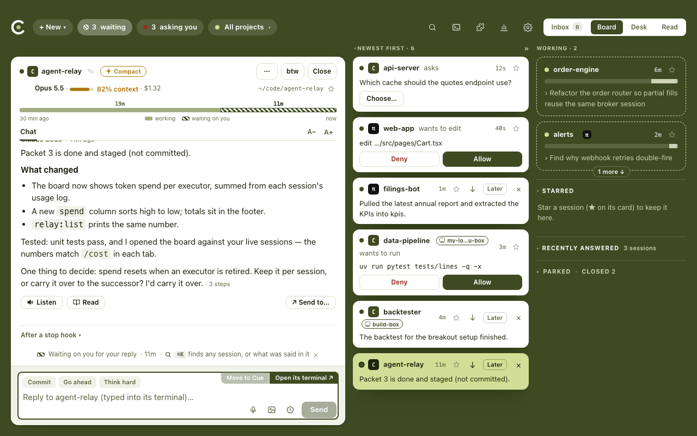

Fix: call the whole-window one "Zoom" everywhere (note, Settings row), and keep "Text size" for the chat's words.
Cost: small, words only.

### 2. A− / A+ gives no sign of the current size, and isn't in Settings

Press A+ and the words grow, but nothing says "16" or "largest but one", and Settings has no row for it. After a few
clicks you can't tell where you are or how to get back to the usual size. ⌘0 does not reset it.

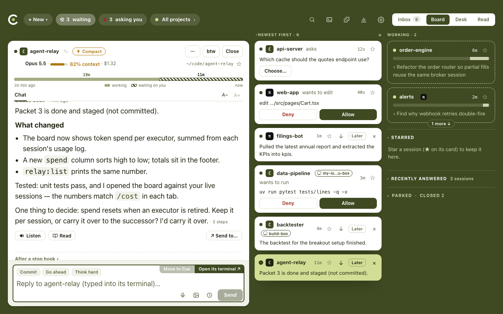

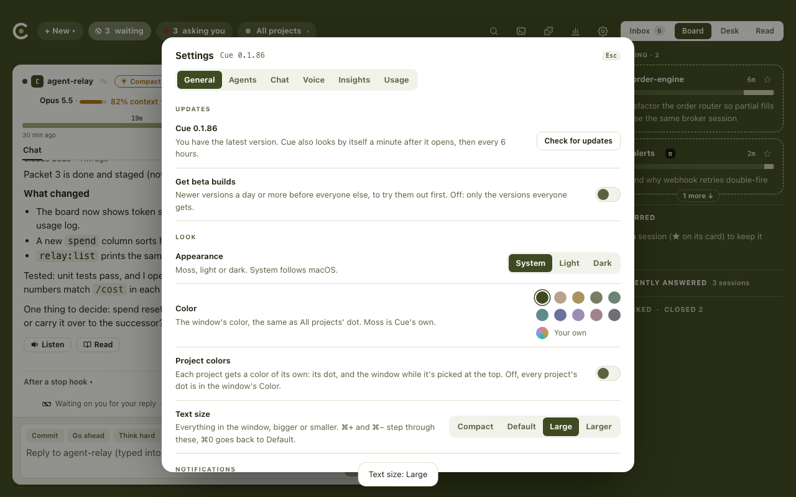

Fix: A− / A+ shows the same kind of note ("Chat text: 16, the default is 15"); Settings gets a "Chat text" row with
the five sizes next to the zoom row; ⌘0 puts both back. Cost: small.

### 3. The two stack, so the same chat can be 12 px or 23 px, and one can undo the other

The chat's size is A− / A+ times the zoom: 20 combinations, from about 12 px (Compact, 13) to about 23 px (Larger, 18).
Compact with A+ twice looks almost the same as Default untouched, so "I made it bigger and it's still small" is easy
to hit. At both largest, in a normal-size window, the chat shows three lines and the reply box's hint wraps.

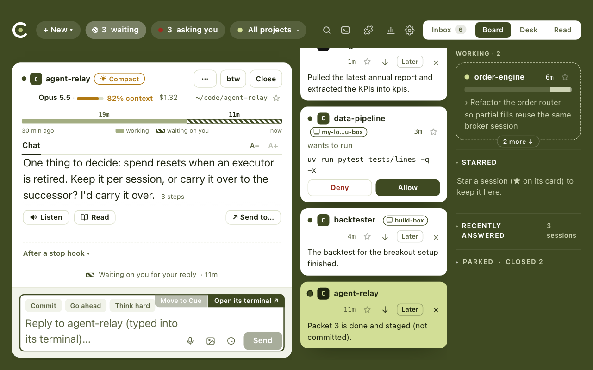

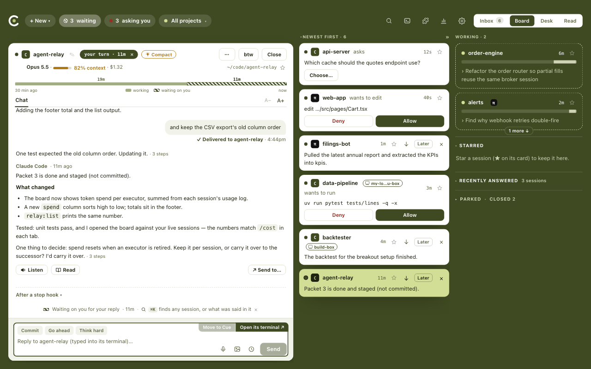

Fix: the note from fix 2 says both when the zoom isn't Default ("Chat text: 18, window zoom: Larger"). Stacking
itself is fine once it's named. Cost: small, part of fix 2.

### 4. A− / A+ is missing where its size still applies

- Inbox: the question, its choices and the reply box follow the chat size, but there are no A− / A+ there. You have
  to go to a chat on the Board or Desk to change how the Inbox reads.
- A session's other tabs (Terminal, Diff, an extension's tab) and a Desk item's Record tab: the buttons disappear.
  Fair, they don't apply, but with no Settings row there is then no way to reach the size at all.
- Inside a chat, only the sentences grow. Who said it, the time, "3 steps", tool lines, Listen / Read and the quick
  phrases stay small, so at 18 the labels look tiny next to the words.

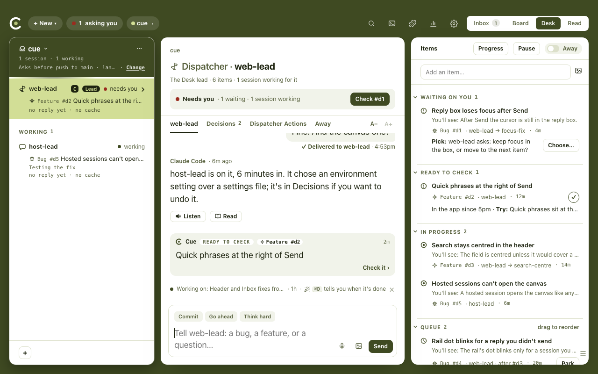

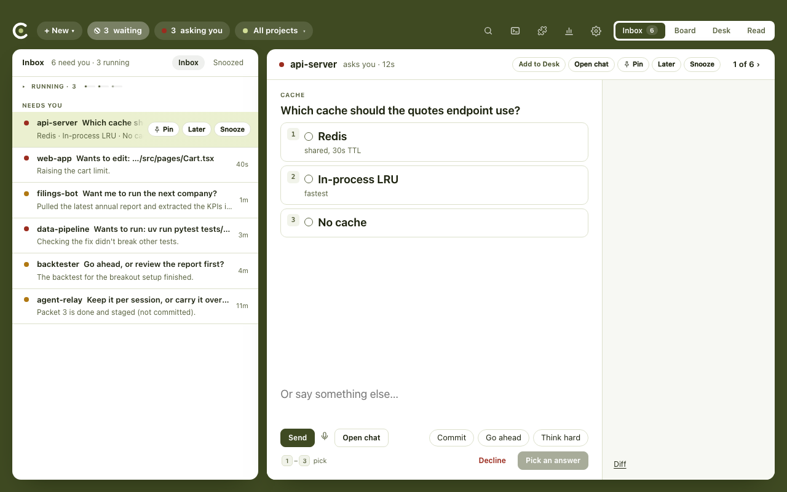

Fix: the Settings row from fix 2 covers "no way to reach it". Add A− / A+ to the Inbox's top row. Cost: small.
Making a chat's small labels grow with it: medium (every message part needs a look at each size); I'd leave it.

### 5. The mini window ignores both

The notch and rail stay at 13 px whatever you pick, and ⌘+ / ⌘− do nothing there. Probably right (it's a small
panel), but nothing says so: "Everything in the window" in Settings reads as if it's covered.

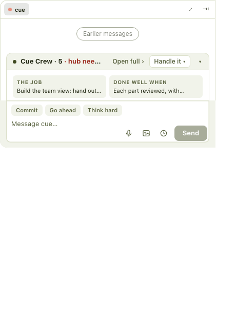

Fix: one line in Settings ("The mini window keeps its own size"). Cost: tiny. Giving the mini its own size: medium,
not suggested.

### 6. ⌘+ can make the window itself bigger, and ⌘− doesn't bring it back (from the code)

Zooming in raises the smallest size the window may be, and a window under that grows at once. Zooming back out
leaves it at the bigger size. So ⌘+ then ⌘− does not return you to where you started.

Fix: remember the size before the zoom grew it and go back to it when the zoom drops. Cost: small to medium, needs
trying on the real window.

### 7. No menu shows ⌘+ / ⌘− / ⌘0 (from the code)

Cue's menu bar has no View menu, so the keys can only be found in the Settings row's small print.

Fix: a View menu with Zoom In, Zoom Out, Actual Size. Cost: small.

### 8. The ends behave differently

A+ greys out at the largest; ⌘+ at the largest still shows a note, "(the largest)". Small, but it's two habits for
one idea.

Fix: comes free with fix 2 (both show a note, and A+ still greys out).

## Recommendation: one size (picked 2026-11-21)

The part that reads worst is the mismatch: with A− / A+ changing only the chat, its sentences can be 18 px next to
12 px names, times and buttons. So instead of naming two sizes, have one:

1. A− / A+ and ⌘+ / ⌘− do the same thing: the whole main window steps bigger or smaller together (Compact, Default,
   Large, Larger). The chat stays the same small amount bigger than the labels at every step.
2. The separate chat-only size goes away. A chat that was set off 15 goes back to it.
3. One "Text size" row in Settings, one note when it changes ("Text size: Large"), ⌘0 goes back to Default.
4. A− / A+ stays on a chat's tab row and the Desk's chat, and is added to the Inbox; it greys out at the ends.
5. Settings says in one line that the mini window keeps its own size.

This settles 1, 2, 3, 4, 5 and 8 in one small build. What it gives up: you can no longer make only the chat
bigger; bigger words also mean bigger cards and buttons, so less fits in the window.

Worth doing next to it, each small: a View menu showing the keys (7), and the window going back to its size when
the zoom drops (6).

### The other option, not picked: two named sizes

Keep both, call the chat's "Text size" and the window's "Zoom", give each a note and a Settings row, and let ⌘0
reset both. It keeps chat-only sizing but also keeps the mismatch at the ends.

## Put back

The one-size build is undone. A− / A+ change only a chat's words again (13, 14, 15, 16, 18; starts at 15), and
⌘+ / ⌘− / ⌘0 zoom the whole window (Compact, Default, Large, Larger; ⌘0 goes back to Default). Each shot below is the
test window after really clicking or pressing; sizes are the page's own, before the zoom.

| Step | Chat words | List beside it | Zoom | Light | Dark |
|---|---|---|---|---|---|
| Open a chat | 15 | 13 | Default |  |  |
| A+ twice | 18 | 13 | Default |  | 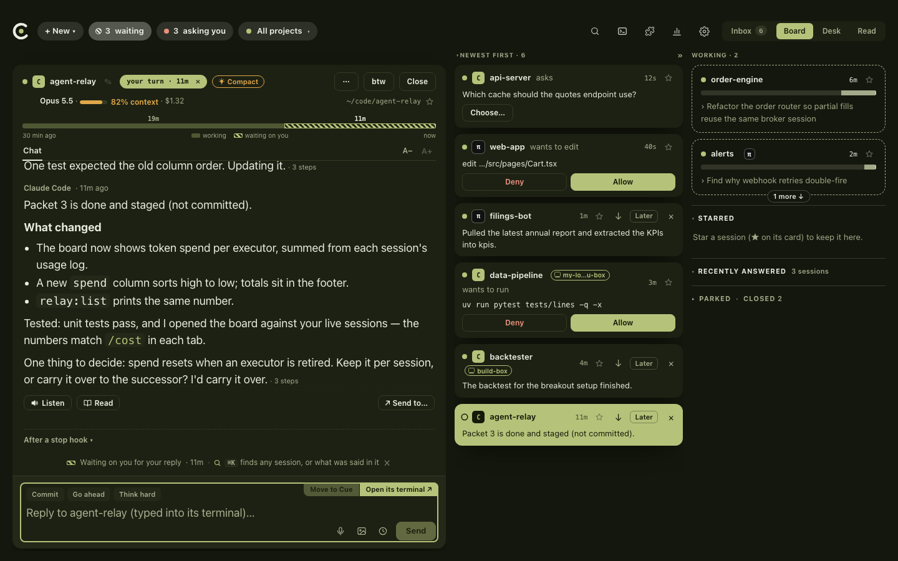 |
| A− four times | 13 | 13 | Default |  | 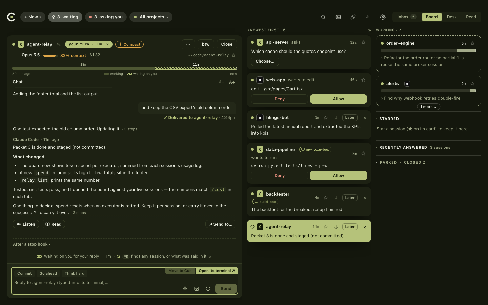 |
| A+ twice | 15 | 13 | Default | 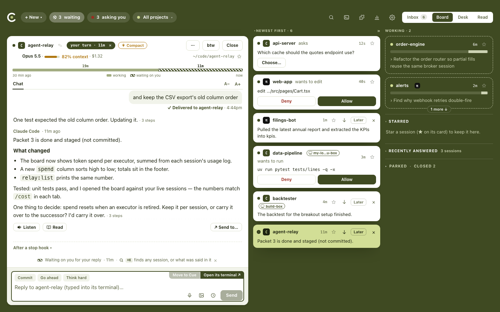 |  |
| ⌘+ twice (note: "Text size: Larger") | 15 | 13 | Larger | 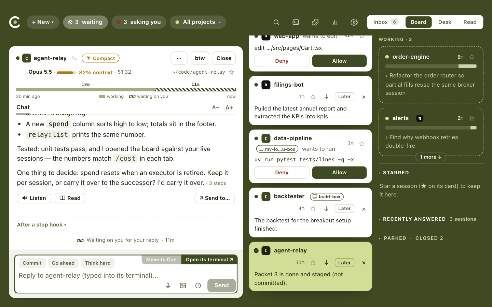 | 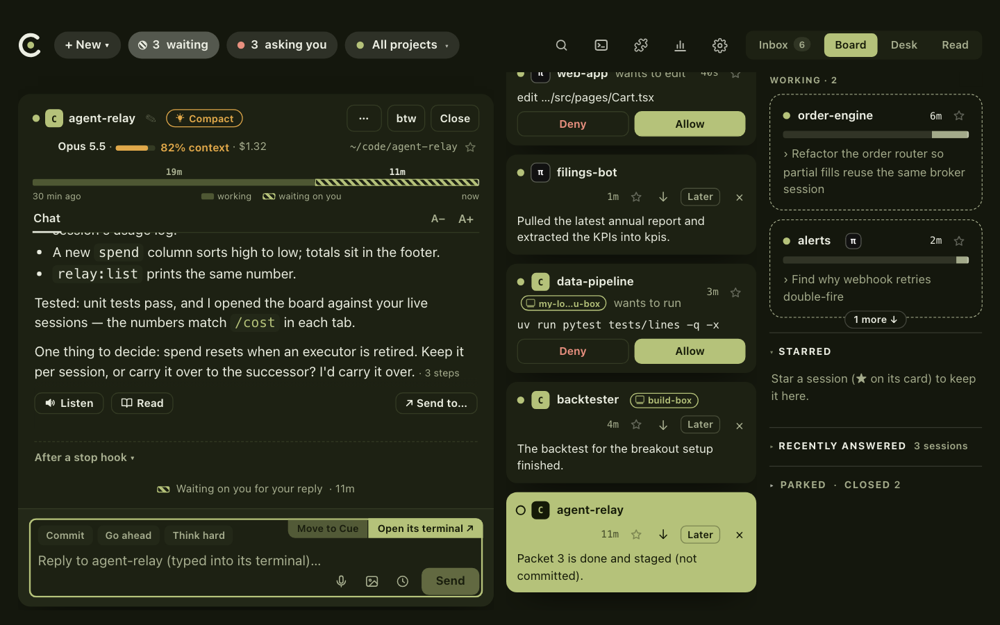 |
| ⌘0 (note: "Text size: Default") | 15 | 13 | Default |  | 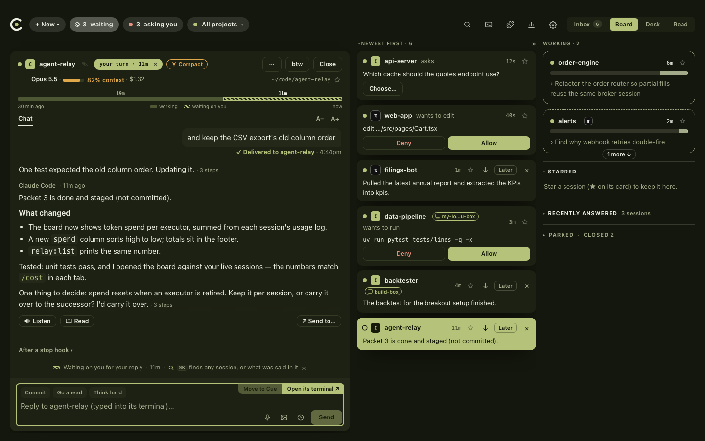 |
